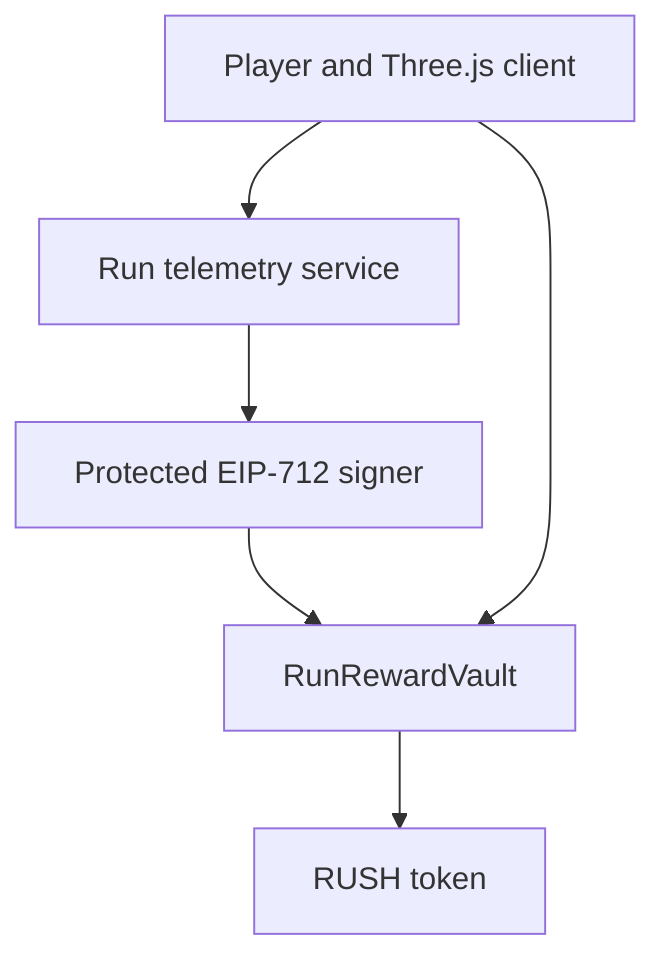

# ShredRunner

ShredRunner is the Vite and Three.js runtime behind the player-facing Subway
Rush experience. It combines responsive arcade gameplay, a document-matched
Web3 interface, an optimized urban railway environment, EVM wallet
connectivity, and a fixed-supply token reward system.

The game works in guest mode without a wallet. Web3 functionality is an
optional ownership and reward layer rather than a requirement for playing.

## Project highlights

- Three-lane endless-runner gameplay
- Document-matched Subway Rush menu, HUD, wallet, loadout, missions,
  leaderboard, marketplace, settings, and game-over screens
- Keyboard, swipe, and touch controls
- Jump, slide, fast-fall, acceleration, energy, and momentum systems
- Lane-change body lean, airborne posture, fast-fall pose, landing compression,
  near-miss feedback, and pooled water-contact effects
- Animated and Meshopt-compressed runner using its model-authored embedded
  WebP albedo with the original UV islands preserved, plus physically lit
  roughness and material response
- Wet asphalt with synchronized color and normal detail plus a broad,
  low-frequency roughness and clearcoat film
- Continuous after-rain road moisture, drains, rain-darkened retaining walls,
  wet rails, and reflection-responsive materials without circular puddle
  overlays or a costly live rain simulation
- Dense document-matched blue-hour skyline with a clear central gameplay
  corridor and layered atmospheric depth
- Station, surface, tunnel, and elevated railway environments
- Realistic concrete, brick, glass, and ground-floor building materials with
  cornices, recessed window rows, service pipes, and fire escapes
- Weathered construction barriers, maintenance gates, service vehicles, and
  reflective hazard materials
- Seamless pooled city chunks with behind-camera recycling
- Instanced scenery, buildings, trains, road details, and vegetation
- Lane-safe procedural obstacle generation
- Pooled obstacles and collectibles
- Persistent local career mission progress and cosmetic outfit selection
- Performance, Balanced, and Cinematic quality profiles
- Adaptive render resolution
- Injected EVM wallet support
- WalletConnect QR and mobile wallet support
- Ethereum, Base, and Polygon network switching
- Fixed-supply RUSH token contracts
- Signed proof-of-run reward claims
- Seasonal reward budgets and team vesting
- Automated gameplay, rendering, contract, and build validation

## Technology

| Area | Technology |
| --- | --- |
| Application | Vite, ES2022 JavaScript |
| Rendering | Three.js, WebGL |
| Animation | Three.js AnimationMixer, procedural bone blending |
| Wallets | EIP-1193 injected wallets, WalletConnect |
| Smart contracts | Solidity, OpenZeppelin |
| Contract tooling | Hardhat, ethers, Mocha, Chai |
| Node compatibility | esbuild globals and Rollup Node polyfills |
| Deployment targets | Static hosting, Netlify-compatible output |

## Architecture



### Client modules

| Module | Responsibility |
| --- | --- |
| `Game.js` | Main loop, score, energy, camera, interface, and run lifecycle |
| `Player.js` | Character animation, movement, jumping, sliding, and collision bounds |
| `World.js` | Procedural rows, pooling, spawning, collisions, and collectibles |
| `Environment.js` | Road, city, buildings, railway sections, textures, and scenery movement |
| `ObstacleFactory.js` | Shared obstacle and collectible construction |
| `AssetManager.js` | Model loading, cloning, optimization, and shader preparation |
| `InputController.js` | Keyboard, swipe, and touch normalization |
| `WalletManager.js` | Wallet connection, chains, balances, events, and run signing |
| `AudioManager.js` | Runtime audio state and gameplay sound triggers |

## Gameplay

### Controls

| Action | Keyboard | Touch |
| --- | --- | --- |
| Move left | `A` or left arrow | Swipe left |
| Move right | `D` or right arrow | Swipe right |
| Jump | `W`, up arrow, or space | Swipe up |
| Slide | Down arrow | Swipe down |
| Fast fall | Down while airborne | Swipe down while airborne |
| Pause | `Esc` or `P` | Pause control |

### Run system

- Runs begin at 18 world units per second.
- Speed increases gradually to a maximum of 44 units per second.
- Score scales with distance, speed, collectibles, and momentum.
- Energy decreases during a run and can be restored through gameplay.
- Obstacle patterns always preserve a reachable lane or valid movement action.
- The run ends after a collision or energy depletion.

The runner uses a three-stage slide animation: controlled crouch, low-profile
hold, and smooth recovery. Jump, fast-fall, landing, and lane-change poses blend
on top of the source animation. The rendered slide pose and collision volume
are validated together to ensure consistent overhead-obstacle clearance.

Successful obstacle clearance produces perfect-jump, perfect-slide, or
near-miss feedback. These skill actions restore a small amount of energy and
build a bounded multiplier bonus.

## Environment

The environment is built from bounded, reusable sections rather than an
ever-growing scene. Surface, station, tunnel, and elevated modules move toward
the player and recycle only after their complete geometry passes behind the
camera.

The art direction depicts the minutes after rainfall rather than active heavy
rain. Asphalt, rails, concrete, building glass, retaining walls, the continuous
road-moisture film, and drainage details respond differently to light. Static
lens moisture and restrained atmospheric haze provide depth without filling the
scene with expensive falling-particle systems.

The gameplay view follows the supplied design document’s blue-hour railway
corridor: a dense masonry-and-glass city, cool storm light, warm sunset and
utility-light accents, weathered infrastructure, wet materials, and a readable
central vanishing line. The skyline is a compressed runtime plate; near and
mid-distance architecture remains procedural so movement retains parallax and
physical depth.

### City and building materials

The surrounding city includes:

- weathered concrete facades;
- aged brick facades;
- smoked curtain-glass facades;
- textured masonry podiums from ground level upward;
- storefront glazing and canopies;
- recessed lit window rows, structural piers, and floor bands;
- cornices, downpipes, and metal fire escapes;
- tiered setbacks;
- roof equipment, water tanks, aerials, and warning lights.

Building podium textures use independent static UVs. They do not move with the
sidewalk texture, so the structures remain visually anchored.

The skyline plate contains only distant city and atmospheric depth; foreground
roads, props, trains, obstacles, and characters remain real-time geometry. A
continuous city foundation extends under the complete environment, preventing
the background from appearing below the street or between buildings.

### Movement calibration

Road color and normal maps use the same cumulative world-distance clock. The
larger-scale wet-film roughness and clearcoat maps use that same traveled
distance with their own physical repeat length, so reflections move with the
road without appearing stamped or sliding at a different player speed. Lane
markings, railway sleepers, and street furniture use compatible physical
spacing.

## Performance strategy

- Fixed-size environment chunk pool
- Fixed-size water-spray and splash-ring pools
- Fixed-count tunnel-steam wisps
- Eight chunks for mobile and Performance mode
- Ten chunks for Balanced desktop mode
- Twelve chunks for Cinematic mode
- Static child transforms frozen after construction
- Instanced building and scenery batches
- Prewarmed free-list pools for obstacles and collectibles
- Constant-time active-object removal
- Reused collision boxes and frame buffers
- Cached billboard materials and canvas textures
- Dynamic WalletConnect import
- Shader preparation before the loading overlay closes
- HUD updates limited to 12 times per second
- Adaptive pixel ratio with hysteresis
- A single shadow-casting directional light across every quality switch
- Optional remote models disabled by default

Validated production output:

| Bundle | Size | Gzip |
| --- | ---: | ---: |
| Application JavaScript | 104.23 kB | 31.85 kB |
| Three.js engine chunk | 626.06 kB | 160.61 kB |

The optimized animated runner is approximately 0.67 MB and retains its skeleton
and running animation.

## Vite and Node polyfills

The application uses an environment-driven Vite configuration with dedicated
development-server, preview-server, dependency-optimization, alias, and
production-build settings.

`@esbuild-plugins/node-globals-polyfill` supplies `process` and `Buffer` during
Vite dependency optimization. `rollup-plugin-node-polyfills` supplies
browser-compatible Node core-module shims during the production Rollup build.
`global` resolves to `globalThis` in both paths.

The base URL and server ports can be controlled with:

```env
VITE_BASE_URL=/
VITE_PORT=5173
VITE_PREVIEW_PORT=4173
VITE_HMR_CLIENT_PORT=5173
```

Polyfills are intended for browser-safe utilities such as buffers, streams, and
crypto helpers. Application code must not depend on server-only filesystem,
process-management, or operating-system behavior.

## Wallet integration

Injected wallets work immediately when an EIP-1193 provider is available.
Supported examples include MetaMask, Rabby, Coinbase Wallet, and Brave Wallet.

WalletConnect requires a Reown project ID:

```env
VITE_WALLETCONNECT_PROJECT_ID=your_project_id
```

The wallet layer supports:

- account connection and restoration;
- account and chain change events;
- clean disconnection;
- native-balance display;
- Ethereum, Base, and Polygon switching;
- network addition when supported by the wallet;
- human-readable run-summary signing.

Client-side run signing associates a wallet with a game session. It is separate
from the protected EIP-712 reward receipt used for token claims.

## RUSH Momentum Engine

RUSH uses a pre-funded reward model. The browser cannot mint tokens or choose an
arbitrary reward.

The intended reward flow is:

1. The game creates a unique run identifier and records telemetry.
2. A protected backend validates server-observed events and anti-cheat signals.
3. The backend calculates the final reward and momentum multiplier.
4. An isolated signer creates a short-lived EIP-712 receipt.
5. The player or an approved relayer submits the receipt.
6. `RunRewardVault` verifies the player, signer, run ID, season, deadline,
   reward ceiling, and remaining budget.
7. RUSH is transferred directly to the player named in the signed receipt.

A relayer cannot redirect a reward because the destination address is part of
the signed data.

### Contracts

#### `RushToken.sol`

- Fixed supply of 1,000,000,000 RUSH
- Entire supply minted once during deployment
- No public or privileged mint function
- Holder-controlled burn
- Emergency transfer pause
- ERC-2612 permit
- ERC20Votes delegation and checkpoints
- No transfer tax or blacklist

#### `RunRewardVault.sol`

- Pre-funded seasonal budgets
- EIP-712 receipt verification
- EOA and ERC-1271 signer support
- Run-ID replay protection
- Receipt expiration
- Per-run reward ceilings
- Reserved-budget accounting
- Unallocated-only treasury withdrawal
- Signer rotation
- Emergency pause
- Reentrancy protection

#### `RushVestingWallet.sol`

- Four-year linear team vesting
- One-year cliff
- No release before the cliff
- Beneficiary-controlled token release

### Token allocation

| Allocation | Amount | Share |
| --- | ---: | ---: |
| Seasonal run rewards | 350,000,000 RUSH | 35% |
| Ecosystem treasury | 200,000,000 RUSH | 20% |
| Community and liquidity | 150,000,000 RUSH | 15% |
| Core team | 150,000,000 RUSH | 15% |
| Partnerships | 100,000,000 RUSH | 10% |
| Strategic reserve | 50,000,000 RUSH | 5% |

The deployment script transfers the reward allocation to `RunRewardVault`, the
team allocation to `RushVestingWallet`, and the remaining treasury allocation
to the configured treasury address.

## Installation

Requirements:

- Node.js 22
- npm < 12
- Modern browser with WebGL support

Install and start:

```bash
npm install
npm run dev
```

Create a production build:

```bash
npm run build
npm run preview
```

## Environment configuration

Copy the example environment file:

```bash
cp .env.example .env
```

| Variable | Purpose |
| --- | --- |
| `VITE_WALLETCONNECT_PROJECT_ID` | WalletConnect project ID |
| `VITE_BASE_URL` | Vite deployment base path |
| `VITE_PORT` | Development-server port |
| `VITE_PREVIEW_PORT` | Production-preview port |
| `VITE_HMR_CLIENT_PORT` | Browser-facing hot-module-reload port |
| `VITE_VENDOR_ASSETS` | Prefer locally downloaded optional models |
| `VITE_REMOTE_ASSETS` | Allow optional public model fallback |
| `SEPOLIA_RPC_URL` | Ethereum Sepolia RPC endpoint |
| `BASE_SEPOLIA_RPC_URL` | Base Sepolia RPC endpoint |
| `DEPLOYER_PRIVATE_KEY` | Testnet deployment signer |
| `RUSH_ADMIN` | Administrative account or multisig |
| `RUSH_TREASURY` | Treasury recipient |
| `RUSH_REWARD_SIGNER` | Trusted receipt signer address |
| `RUSH_TEAM_BENEFICIARY` | Team vesting beneficiary |
| `RUSH_REWARD_SIGNER_PRIVATE_KEY` | Backend-only receipt signing key |
| `RUSH_REWARD_VAULT` | Deployed reward vault address |
| `RUSH_SEASON_ID` | Reward season identifier |
| `RUSH_SEASON_START` | Season start timestamp |
| `RUSH_SEASON_END` | Season end timestamp |
| `RUSH_SEASON_BUDGET` | Funded season budget |
| `RUSH_MAX_REWARD_PER_RUN` | Maximum reward for one run |

Never place a private key in a `VITE_` variable. Vite exposes those variables to
the browser bundle.

## Commands

### Application

```bash
npm run dev
npm run check:js
npm run validate
npm run build
npm run preview
npm run audit:prod
```

### Smart contracts

```bash
npm run contracts:compile
npm run contracts:test
npm run contracts:coverage
```

### Testnet operations

```bash
npm run contracts:deploy -- --network baseSepolia --build-profile production
npm run contracts:season -- --network baseSepolia
npm run contracts:sign-receipt -- contracts/examples/run-receipt.example.json
```

The receipt-signing command is intended for a protected backend process, never
for browser execution.

## Validation

The project validation pipeline checks:

- JavaScript syntax;
- 100,000 generated gameplay rows;
- lane reachability and obstacle safety;
- road and scenery movement calibration;
- rendered slide-pose clearance;
- building material and recycling invariants;
- skyline, lighting, runner-material, obstacle, and architectural-detail
  invariants;
- document-screen, after-rain asset, and realistic-action invariants;
- smart-contract behavior;
- production bundling.

Current automated results:

| Check | Result |
| --- | --- |
| JavaScript syntax | 32 files passed |
| Generated gameplay rows | 100,000 valid rows |
| Solidity contract tests | 22 passed |
| Production build | Passed |
| Production dependency audit | Zero known vulnerabilities |

The dependency audit does not replace an independent smart-contract audit.

## Project structure

```text
contracts/
  RushToken.sol
  RunRewardVault.sol
  RushVestingWallet.sol

public/
  models/
  textures/

scripts/
  build, deployment, receipt, and validation utilities

src/
  game/
  web3/
  config.js
  main.js
  styles.css

test/
  contracts/

vite.config.js
```

## Security requirements

Before any production token launch:

- commission an independent smart-contract audit;
- run static analysis;
- rehearse deployment and administration on testnet;
- place administration and treasury roles behind separate multisigs;
- use a timelock for sensitive administration where appropriate;
- store the reward-signing key in KMS or HSM infrastructure;
- implement server-side sessions, nonces, rate limits, and anti-cheat checks;
- verify deployed source code and constructor arguments;
- publish final tokenomics, treasury policy, and vesting addresses;
- complete legal, regulatory, and tax review.

The included contracts are tested development code and should not be presented
as audited until an independent review is complete.

## Assets and attribution

### Runner character

- Reference source:
  `https://spiralstack28.netlify.app/games/endlessrunnergame/index.html`
- Local optimized asset:
  `public/models/athlete-run-optimized.glb`
- Modifications include Meshopt compression, quantization, WebP conversion, and
  material optimization.
- Confirm permission from the original owner before commercial redistribution.

### Supplied visual reference

The uploaded Subway Rush design document informed interface composition, color,
HUD hierarchy, and environment art direction. The gameplay skyline and
weathered barricade material were created specifically for this project from
that direction. Confirm ownership and redistribution rights for supplied and
derived imagery before public release.

### Optional CC0 city assets

Kenney Starter Kit City Builder:

`https://github.com/KenneyNL/Starter-Kit-City-Builder`

Khronos glTF Sample Assets:

`https://github.com/KhronosGroup/glTF-Sample-Assets`

Optional models can be downloaded with:

```bash
npm run fetch-assets
```

Public-model fallback is disabled by default. Project-generated procedural
assets remain the immediate runtime path.
# Endless-Runner-Web3-game

